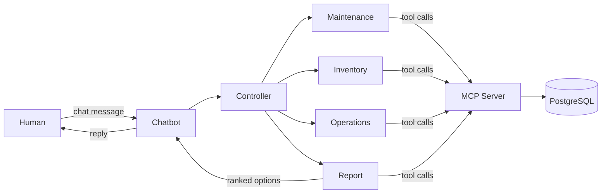

# AOG Recovery Coordinator: Agent Interaction Model

Companion to `propsal.md` (section 6 Agent Architecture, section 9 Tool & API Mapping).
Describes what each agent receives, what it hands back, and which data tools it uses to reach the database.

## Decisions so far

| Topic | Choice |
|---|---|
| How agents reach data | MCP server exposing named tools (confirmed) |
| Database | PostgreSQL |
| Data | Mock data, demo scenario: aircraft FX123, hydraulic pump failure |
| Access | Read-only, except two writes: the Controller creating the AOG event and Report Creation saving the final report |
| AOG event creation | Done by the Controller Agent from the human's report |
| Human interface | Chatbot using the ADK built-in web chat: the human reports the AOG and receives the ranked options in the same conversation |
| Delay impact | Operations lists affected flights only, no cost figure |
| First slice to build | Parts availability (Inventory Agent) |

## In plain words

- **Agent**: a specialist that does one job and asks questions.
- **MCP tool**: a named question an agent can ask the data service, e.g. `check_part_stock`. The agent never touches the database directly.
- **MCP server**: the single front desk that receives those questions, looks in PostgreSQL, and returns the answer.
- **AOG event**: the case file. Every agent works on the same `event_id` so answers stay together.



## Shared message shape

Every request to a specialist agent carries:

| Field | Meaning |
|---|---|
| `event_id` | Case identifier |
| `aircraft_id` | e.g. `FX123` |
| `fault` | Short fault description and code |
| `station` | Airport where the aircraft is grounded |

Every reply carries: `event_id`, `agent`, `findings`, `confidence` (low/medium/high), `assumptions`, `data_as_of` (timestamp of the data used).

## Per-agent interactions

### Controller Agent
- **Job**: opens the case, asks each specialist, passes findings to Report.
- **Input**: the human's AOG report typed in the chatbot, e.g. "FX123 grounded at MEM, hydraulic pump failure". The Controller extracts aircraft, fault, and station, and asks a follow-up question in the chat if any is missing.
- **Output**: a new `event_id`, delegated requests to specialists, final handoff to Report Creation. Progress and the final ranked options are returned to the human in the chat.
- **Tools**:

| Tool | Input | Returns |
|---|---|---|
| `create_aog_event` | `aircraft_id`, `fault`, `station` | New `event_id` (write) |
| `get_aog_event` | `event_id` | Case details |

### Maintenance Agent
- **Job**: can it be repaired, how long, and which part does it need?
- **Input**: `aircraft_id`, `fault`.
- **Output**: `repair_feasible` (yes/no/conditional), `estimated_repair_hours`, `required_parts` (part numbers), `blocking_issues`.
- **Tools**:

| Tool | Input | Returns |
|---|---|---|
| `get_open_work_orders` | `aircraft_id` | Open work orders |
| `get_maintenance_history` | `aircraft_id`, `system` | Past repairs on that system |
| `get_repair_standard` | `fault_code` | Standard repair steps and hours |

### Inventory Agent (start here)
- **Job**: is the needed part available, where, and how fast can it arrive?
- **Input**: `required_parts` from Maintenance, `station`.
- **Output**: per part: `available_at_station` (qty), `available_elsewhere` (station, qty, transfer hours), `alternates`, `supplier_lead_time_hours`, `readiness` (ready / transfer needed / order needed).
- **Tools**:

| Tool | Input | Returns |
|---|---|---|
| `check_part_stock` | `part_number`, `station` | Quantity on hand per location |
| `find_alternate_parts` | `part_number` | Approved substitute part numbers |
| `get_supplier_availability` | `part_number` | Supplier stock and lead time |

### Operations Agent
- **Job**: which flights does the grounding affect, and can another aircraft cover?
- **Input**: `aircraft_id`, `station`, estimated recovery time window.
- **Output**: `affected_flights` (list only, no cost figures), `spare_aircraft_options`, `swap_recommendation`.
- **Tools**:

| Tool | Input | Returns |
|---|---|---|
| `get_flight_schedule` | `aircraft_id`, time window | Upcoming flights |
| `find_substitute_aircraft` | aircraft type, station, window | Available spares |
| `get_downstream_flights` | `flight_id`, delay hours | Later flights on the same aircraft rotation that would be affected |

### Report Creation Agent
- **Job**: combines everything into ranked recovery options for the human.
- **Input**: findings from Maintenance, Inventory, Operations.
- **Output**: ranked options (Repair Now, Transfer Part, Swap Aircraft, Delay Flight), each with time to recover, key trade-off, assumptions, risks, and a recommended pick. Advisory only.
- **Tools**:

| Tool | Input | Returns |
|---|---|---|
| `save_recommendation_report` | `event_id`, report | Saved report id (write) |
| `get_event_findings` | `event_id` | All specialist findings for the case |

## Worked example: FX123 hydraulic pump failure

Illustrative only. All values come from mock data and are not from a real incident.

### What happens behind the scenes

| Step | Who | Action | Tool called |
|---|---|---|---|
| 1 | Human | Types the AOG report in the chat | |
| 2 | Controller | Opens the case, gets `AOG-0001` | `create_aog_event` |
| 3 | Maintenance | Finds a 3-hour repair, needs pump `HP-2210` | `get_repair_standard`, `get_open_work_orders` |
| 4 | Inventory | Pump out of stock at MEM, 2 at IND (about 6 hours transfer), one approved alternate with 24-hour supplier lead time | `check_part_stock`, `find_alternate_parts`, `get_supplier_availability` |
| 5 | Operations | Lists affected flights per option, finds a spare aircraft at MEM | `get_flight_schedule`, `find_substitute_aircraft`, `get_downstream_flights` |
| 6 | Report Creation | Ranks the options and saves the report | `get_event_findings`, `save_recommendation_report` |
| 7 | Human | Reviews and approves or rejects | |

### What the human sees in the chat

```text
You:        FX123 is grounded at MEM, hydraulic pump failure.

Controller: Case AOG-0001 opened. Asking my team...

Recovery options for FX123 (AOG-0001)

1. Transfer Part   (RECOMMENDED)
   - Pump is out of stock at MEM, but 2 are in stock at IND
   - Estimated back in service: about 9 hours (6 transfer + 3 repair)
   - Affected flights: FX401, FX812
   - Trade-off: two delayed flights, but no spare aircraft needed

2. Swap Aircraft
   - Spare aircraft available at MEM
   - Estimated back in service: about 3 hours
   - Affected flights: FX401
   - Trade-off: faster, but uses up the spare

3. Delay Flight (wait for supplier or alternate part)
   - One approved substitute pump, supplier lead time 24 hours
   - Affected flights: FX401, FX812, FX955
   - Trade-off: slowest option

Assumptions: stock data as of 13:10 today; repair estimate from the standard repair guide.
These are suggestions only. Please review and approve before any action.
```

## Database sketch (PostgreSQL, mock data)

`aircraft`, `aog_events`, `work_orders`, `maintenance_history`, `repair_standards`, `parts`, `parts_inventory`, `part_alternates`, `supplier_stock`, `station_transfers`, `flights`, `recommendation_reports`

Files in `db/`:
- `schema.sql`: tables and the read-only and write database roles.
- `seed.sql`: FX123 mock rows (pump `HP-2210` at 0 in MEM, 2 in IND; alternate `HP-2215`; spare aircraft `FX207`; flights `FX401`, `FX812`, `FX955`).
- `verify.sql`: queries that check the data gives the answers in the worked example.

Run in order: `schema.sql`, `seed.sql`, `verify.sql`.

Mock data should include the FX123 case: a hydraulic pump part that is out of stock at the grounded station but available at another station, with one alternate.

## Provisioning plan

1. **Agree the scenario**: lock the FX123 story and the expected best answer, so the demo can be checked.
2. **Create the database**: PostgreSQL with the tables above and mock rows. Use a read-only database user for agents and a separate write user limited to `aog_events` and `recommendation_reports`.
3. **Build the MCP server, parts first**: implement `check_part_stock`, `find_alternate_parts`, `get_supplier_availability` and test them without any agent.
4. **Add the Inventory Agent**: connect it to those tools and confirm it answers the FX123 part question.
5. **Add Maintenance, then Operations**: tools and agents one at a time.
6. **Add Controller and Report Creation**: wire the full flow and save the report.
7. **Use the ADK built-in chat**: run the Controller as the root agent in the ADK web chat so the human's message reaches it and the reply, including the approval step, shows in the chat. No custom front end to build.
8. **Guardrails check**: read-only enforced at the database level, tool whitelist per agent, audit log of every tool call, human approval before any action.
