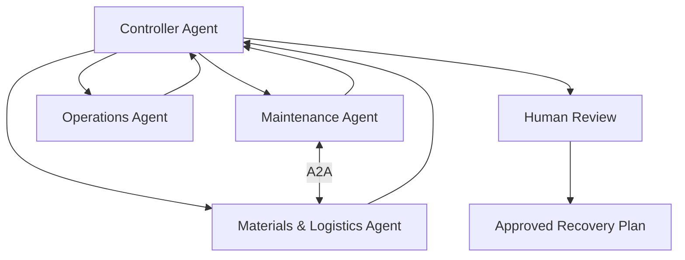
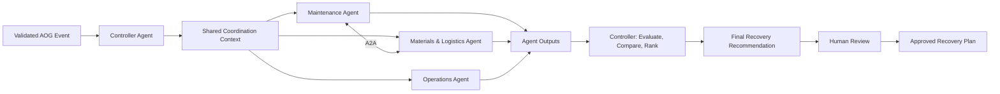
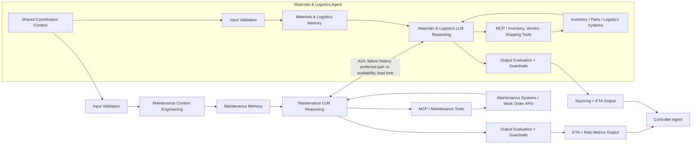
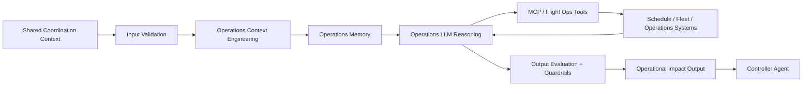
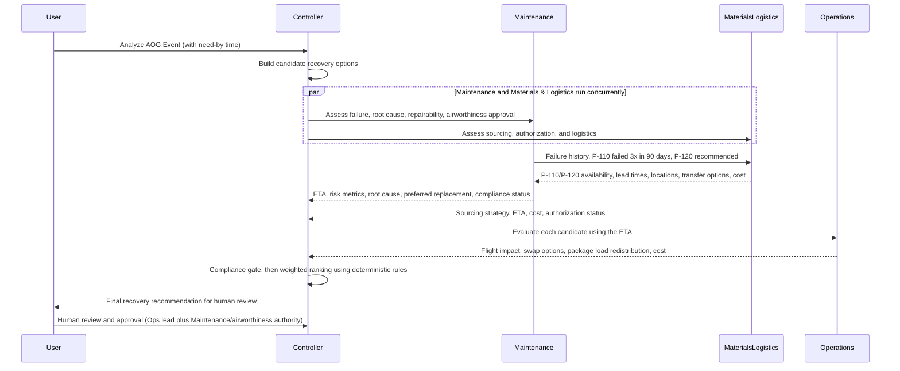

# Aircraft-On-Ground (AOG) Recovery Coordinator
## FDEUS03 Capstone Project
### Agent-to-Agent (A2A) Recovery Decision Support System using Google ADK

> Enterprise Capstone Proposal for Air Operations Workbench

---

# 1. Executive Summary

The Aircraft-On-Ground (AOG) Recovery Coordinator is an Agent-to-Agent (A2A) decision-support platform built using Google ADK. Four agents (Controller Agent (Recovery Coordinator), Maintenance Agent, Materials & Logistics Agent, and Operations Agent) collaborate to identify the recovery strategy that best balances recovery speed, operational impact, cost, risk, and compliance (maintenance, engineering, approved-part, and airworthiness requirements).

The goal is to reduce AOG duration and accelerate recovery decisions, improve decision quality and consistency, and provide explainable recommendations while keeping humans fully accountable for all operational and airworthiness decisions. The solution is a decision-support platform, not an autonomous decision-maker.

The Aircraft-On-Ground Recovery Coordinator uses Agent-to-Agent collaboration across Maintenance, Materials & Logistics, and Operations domains to identify the optimal aircraft recovery strategy, reducing downtime and operational disruption while keeping humans fully in control of operational decisions.

Key goals:
- Reduce aircraft downtime
- Evaluate multiple recovery strategies in parallel against technical, operational, regulatory, and business objectives
- Improve recovery decision quality and consistency
- Enable explainable recommendations
- Demonstrate enterprise-grade multi-agent orchestration
- Maintain human approval for operational actions

---

# 2. Business Problem

Aircraft-On-Ground (AOG) events are among the most operationally disruptive and costly situations faced by Air Operations. As a logistics company, FedEx flights carry package delivery loads, so every AOG event also puts time-definite customer shipments at risk and may force those loads to be redistributed across other flights and aircraft.

When an aircraft becomes AOG, Maintenance, Materials & Logistics, and Operations teams must rapidly determine the most effective recovery strategy while balancing operational urgency, inventory availability, engineering guidance, maintenance requirements, and airworthiness obligations.

Today, the information needed to make these decisions is distributed across multiple systems, records, and business functions. Teams often need to manually gather data, consult subject matter experts, review maintenance history, evaluate parts availability, analyze operational impacts, and determine the most appropriate recovery path under significant time pressure.

The challenge is not simply identifying an available replacement part or repair option. The challenge is determining which recovery strategy best satisfies technical, operational, regulatory, and business objectives simultaneously.

## 2.1 Key Recovery Decisions

During an AOG event, teams are typically required to answer critical questions such as:
- Can the aircraft be repaired within the required operational timeframe?
- What is the root cause of the failure, and has a similar issue occurred previously?
- Does maintenance history suggest a preferred repair strategy or replacement component?
- Are there approved alternate parts or engineering-authorized replacements available?
- Is the required part available locally, at another station, or through a supplier?
- Should the part be transferred, borrowed, purchased, or expedited?
- What transportation or logistics options are available, and what are the expected delivery times?
- Can another aircraft be substituted to minimize network disruption?
- What flights, customers, and downstream operations will be impacted by each recovery option?
- How would the package load on the affected flights be redistributed (to other flights or a substitute aircraft), and which time-critical shipments and service commitments are at risk?
- Which recovery strategy provides the best balance between recovery speed, operational impact, cost, risk, and compliance?

The challenge is determining which recovery strategy best satisfies:
- Maintenance requirements
- Engineering recommendations
- Approved replacement part standards
- Airworthiness and regulatory obligations
- Inventory and logistics constraints
- Operational recovery objectives
- Package load redistribution and customer service commitments
- Business impact considerations

Because these decisions require balancing multiple competing factors, recovery planning often depends heavily on individual expertise and manual coordination.

As operational complexity increases, the time required to evaluate recovery alternatives can extend aircraft downtime, increase operational disruption, and create inconsistent decision-making outcomes.

There is an opportunity to improve this process through an intelligent decision-support capability that can bring together expertise from Maintenance, Materials & Logistics, and Operations, evaluate multiple recovery strategies in parallel, and provide explainable recommendations that help teams make faster and better-informed recovery decisions while ensuring humans remain fully accountable for all operational and airworthiness decisions.

---

# 3. Value Proposition

Benefits:
- Faster recovery decisions
- More consistent decisions that depend less on individual expertise and manual coordination
- Reduced aircraft downtime
- Visibility of engineering guidance, approved alternates, and airworthiness constraints alongside parts and operational impact
- Improved fleet utilization
- Protected package service commitments through visibility into load redistribution impact
- Better parts visibility across stations and vendors
- Clearer trade-off analysis across recovery options
- Explainable decision support for human operators

---

# 4. Why A2A vs Deterministic Solutions

Deterministic systems typically follow rules such as:

```text
IF part available THEN repair
```

Agentic systems evaluate multiple operational paths. The Controller builds candidate recovery strategies, each combining a repair or aircraft choice, a sourcing method, and a package load-redistribution plan:

```text
Repair with original part
Repair with preferred/alternate part (for example P-120)
Swap Aircraft
Delay Flight
```

Each candidate is first passed through a compliance gate and then ranked on a weighted score (recovery speed 30%, operational/package impact 30%, risk 30%, cost 10%).

The system recommends the best option based on evidence rather than a single hard-coded rule.

## 4.1 Deterministic Responsibilities

These responsibilities are best handled by deterministic logic because they are rule-based and objective:

- Input validation and required-field checks
- Part availability and approved-part authorization checks against inventory thresholds
- Package capacity, sort, and cut-off window checks for load redistribution
- Compliance gate: exclusion of options that fail airworthiness, engineering approval, or part authorization/traceability checks
- Basic schedule conflict detection
- Minimum safety and approval gate checks
- Standard workflow routing and escalation rules
- Structured data transformations and status calculations

## 4.2 Non-Deterministic Responsibilities

These responsibilities require judgment, contextual reasoning, and trade-off analysis because the data is incomplete, dynamic, or conflicting:

- Assessing repairability under uncertain maintenance conditions
- Interpreting partial aircraft history and operational constraints
- Evaluating trade-offs between downtime, cost, risk, and flight and package disruption
- Deciding how to redistribute package load when alternate capacity is limited
- Prioritizing among multiple recovery options with incomplete certainty
- Explaining recommendations in human-understandable terms
- Recommending a coordinated plan across maintenance, materials and logistics, and operations

Recovery options are ranked with a compliance gate (non-compliant options are excluded) followed by a weighted score (recovery speed 30%, operational/package impact 30%, risk 30%, cost 10%). Cost is a mock estimated_cost in USD per option (repair labor + part/transfer/expedite cost + delay/swap cost).

## 4.3 Why Deterministic Logic Cannot Fully Replace the Agents

A deterministic engine is useful for guardrails, validation, and workflow enforcement, but it cannot fully replace the specialized agents in this system because real AOG decisions are not based on one simple rule set. In practice, the system must reason across multiple domains at once:

- A part may be available but still not feasible because of lead time, certification, or maintenance constraints.
- The aircraft may be repairable but not the best option if the schedule impact is severe.
- A substitute aircraft may exist but may create operational or customer disruption elsewhere.
- A recovery option may be fast but infeasible if the displaced package load cannot fit on other flights or aircraft before cut-off.
- A part may be available but unusable if it is not an approved or traceable replacement.
- The best recommendation depends on balancing technical feasibility, material readiness, and operational impact together.

For these reasons, deterministic logic should be used for validation and enforcement, while the agentic layer is used for reasoning, prioritization, and recommendation generation. This division preserves reliability while still enabling judgment-based decision support.

## 4.4 Why This Is Genuine A2A

The Maintenance Agent and Materials & Logistics Agent communicate directly (A2A). The question is not "Do we have the part?" but "What is the most appropriate replacement strategy given maintenance history and part availability?" This is genuine A2A because:

- Agents exchange domain expertise rather than raw data lookups.
- Maintenance history influences inventory and sourcing decisions.
- Alternatives are generated collaboratively.
- Recommendations emerge from multiple perspectives.
- Multiple valid outcomes exist (for example P-110 now versus upgraded P-120 later).
- Decision quality improves through agent interaction.

Worked example: the Maintenance Agent finds that Hydraulic Pump P-110 failed, that a similar failure occurred 3 times in 90 days, and that engineering notes recommend the upgraded P-120. The Materials & Logistics Agent evaluates P-110 availability, P-120 availability, lead times, inventory locations, and transfer options before responding. Every exchange is recorded in the Controller case context.

---

# 5. Solution Overview

The Recovery Coordinator orchestrates a focused decision flow led by the Controller Agent. The controller receives the AOG event, delegates to the specialist agents, synthesizes their findings into ranked options, and then routes the recommendation to the human decision-maker for approval.



The Controller is at the top; Maintenance and Materials & Logistics collaborate directly as peers (A2A); Operations assesses flight and network impact; the Controller ranks the options and delivers the recommendation to Human Review, and only the approved plan is final.

---

# 6. Agent Architecture

Each agent follows the same core pattern: validate input, retrieve local context, reason using an LLM, consult tools or external systems, apply deterministic guardrails, and evaluate the final output before returning it to the Controller or the human decision-maker.

This section describes the role-specific LLM responsibility, the deterministic controls, the non-deterministic reasoning, and the kind of questions each agent is designed to answer.

## Controller Agent
The Controller Agent (Recovery Coordinator) is the main orchestrator, decision synthesizer, and recommendation generator. It receives the AOG event, delegates analysis to the specialist agents, collects findings, evaluates alternatives, compares trade-offs, ranks options, and produces the final recovery plan with explainable recommendations for human review. There is no separate Recovery Recommendation Agent (see ADR-001).

### 6.1 LLM Role
The Controller LLM acts as the coordination planner. It is not expected to make all technical decisions itself; instead, it decides which specialist agents are needed, what information must be gathered, and how to combine the outputs into a coherent recommendation.

**Deterministic responsibilities:** The Controller's deterministic responsibilities, including assembling the final ranked recommendation report from fixed rules and templates, are defined in [agent-proposals/controller-agent-proposal.md](agent-proposals/controller-agent-proposal.md) (Section 9).

### 6.2 Non-Deterministic Responsibilities
- Interpret incomplete or conflicting operational signals
- Decide which agent output is most relevant to the immediate disruption
- Prioritize and sequence the response workflow
- Synthesize a coordinated recovery narrative across teams
- Recommend the most credible decision path for human approval
- Compare trade-offs and rank competing recovery options, explaining the ranking

### 6.3 Questions it seeks to answer
- What is the current AOG event and what decision needs to be made?
- Which specialist agents are relevant to this specific recovery case?
- How should the findings be combined into a single coordinated recommendation?
- What is the best recovery plan to present to the human approver?
- Which information is missing or uncertain and how should that affect the next step?

## Maintenance Agent
The Maintenance Agent assesses failure causes, aircraft repairability, and technical feasibility. It evaluates whether the aircraft can be recovered through repair, estimates repair duration and maintenance constraints, analyzes maintenance history, and detects recurring failures.

### 6.4 LLM Role
The Maintenance LLM acts as the aircraft technical analyst. It interprets maintenance records, repair history, work-order conditions, and engineering constraints to determine whether a repair path is viable under the current state of the aircraft.

### 6.5 Deterministic Responsibilities
- Validate required maintenance data and aircraft status fields
- Detect obvious schedule conflicts or missing required actions
- Apply standard safety and approval checks
- Structure repair options into clear technical categories
- Count recurring failures of the same part within a defined window
- Check airworthiness and engineering approval status (Aircraft Maintenance Technician/Engineer sign-off) for each repair path

### 6.6 Non-Deterministic Responsibilities
- Assess whether the aircraft is truly repairable under uncertain technical conditions
- Interpret partial maintenance history and ambiguous defect descriptions
- Estimate turnaround time when real-world constraints are not fully known
- Balance technical feasibility against operational urgency
- Recommend whether to repair, defer, or escalate a recovery path
- Interpret recurring-failure patterns and recommend preferred replacement parts (for example upgraded P-120 instead of P-110) from historical repairs and engineering notes

### 6.7 Questions it seeks to answer
- Is the aircraft repairable in the current maintenance context?
- What inspection, parts, and labor are required for repair?
- How long will the aircraft need to remain grounded for maintenance?
- What failed, what is the root cause, and has it happened before?
- Can the aircraft be repaired before the need-by time on the AOG event?
- Which repair strategy worked previously, and are alternate parts recommended?
- What technical risks or constraints could affect the recovery option?
- What is the confidence level in the technical recommendation and what assumptions drive it?

## Materials & Logistics Agent
The Materials & Logistics Agent (merger of the former Inventory and Logistics roles, see ADR-001) is a peer of the Maintenance Agent. It covers inventory lookup, alternate and approved substitute part lookup, internal transfer analysis, vendor sourcing, shipping analysis, logistics planning, and ETA calculation. It collaborates directly with Maintenance (A2A) so replacement strategy reflects both maintenance history and part availability.

### 6.8 LLM Role
The Materials & Logistics LLM acts as the materials readiness and sourcing specialist. It combines inventory data, stock availability, supplier/transfer logic, and shipping options with the Maintenance Agent's failure history and preferred-part guidance to determine the best replacement and sourcing strategy under acceptable risk.

### 6.9 Deterministic Responsibilities
- Validate part number, location, quantity, and stock thresholds
- Check current availability against minimum requirements
- Match approved substitute or alternate part candidates using defined business rules
- Check part authorization and traceability (Materials Inventory Specialist (MIS) validation) before a part is offered
- Estimate cost and ETA per sourcing method (transfer, purchase, borrow, expedite) and shipping source (FedEx network or commercial carrier)
- Route sourcing decisions to the correct transfer, vendor, or procurement path
- Compute expected lead times, shipping durations, ETAs, and material readiness status from structured data

### 6.10 Non-Deterministic Responsibilities
- Judge whether a part is feasible even when inventory data is incomplete or stale
- Interpret supplier delays, transfer constraints, shipping risk, or certification risk in practical terms
- Decide whether alternate or upgraded parts are operationally acceptable
- Compare replacement strategies (for example P-110 now versus upgraded P-120) using maintenance history and availability
- Assess trade-offs between sourcing speed and long-term aircraft recovery risk
- Recommend the best sourcing strategy under uncertain supply conditions

### 6.11 Questions it seeks to answer
- Do we have the part, and where are the parts?
- What are the approved alternatives?
- Can inventory be transferred from another station?
- How fast can the part be delivered?
- What is the best sourcing strategy to meet the recovery deadline with acceptable risk?

## Operations Agent
The Operations Agent evaluates the larger business impact of the AOG event, including schedule, substitution, and package load redistribution implications. It assesses how the recovery path affects operations, package service commitments, and customer impact.

### 6.12 LLM Role
The Operations LLM acts as the disruption and prioritization analyst. It interprets flight schedules, fleet constraints, and route dependencies to determine which recovery option minimizes operational disruption while remaining feasible.

### 6.13 Deterministic Responsibilities
- Validate flight and schedule data relevant to the AOG event
- Detect route conflicts, aircraft assignment conflicts, and disruption triggers
- Evaluate standard substitution and re-accommodation rules
- Check aircraft capacity and package sort and cut-off windows when redistributing load
- Assess aircraft availability and fleet utilization
- Apply business priority logic and threshold-based impact checks
- Produce consistent operational impact summaries

### 6.14 Non-Deterministic Responsibilities
- Determine which disruption pattern is most damaging under uncertain schedule conditions
- Assess whether a swap, reroute, or delay is the least-bad recovery option
- Weigh customer impact, crew constraints, and fleet optimization trade-offs
- Evaluate package load redistribution: which packages can move to other flights or a substitute aircraft within capacity, sort, and cut-off windows, and which time-critical shipments remain at risk
- Recommend operational sequencing under incomplete real-time conditions
- Prioritize among multiple plausible recovery paths when the numbers alone are not decisive

### 6.15 Questions it seeks to answer
- What flights or routes are affected, and what is the downstream network impact?
- Can another aircraft be substituted, and is a swap viable?
- What is the operational cost of delay, reroute, or recovery action?
- Which recovery path minimizes business disruption while remaining feasible?
- What is the impact on customer commitments, schedule reliability, and aircraft utilization?
- How should the package load be redistributed across other flights or aircraft, and what service commitments remain at risk?

### 6.16 Design Principle for All Agents
Each agent should be built around the same pattern:
- Input validation
- Context engineering and local memory
- LLM reasoning over domain-specific context
- Tool or API access to relevant systems
- Deterministic guardrails before output release
- Output evaluation before submitting the result to the next stage

This structure makes each role easier to develop as an LLM-based specialist while keeping the overall system coordinated and explainable.

The final recommendation report is assembled by the Controller using deterministic rules and templates, based on the specialist findings from Maintenance, Materials & Logistics, and Operations. When confidence is low or domain signals conflict, the system escalates the case for human review rather than auto-approving a decision.

---

# 7. Individual Agent-Level Architecture

The high-level controller flow is useful for overview, but each specialist agent has its own internal reasoning and memory flow. The architecture below breaks the system down by agent so each role is clearly defined.

## 7.1 Controller Agent Architecture



The Controller Agent is responsible for shared context coordination, task routing, and synthesis of the final recommendation, including evaluating alternatives, comparing trade-offs, and ranking options. It does not own the detailed local reasoning memory for every agent; instead, it keeps only the shared state needed to coordinate the workflow, including a record of the Maintenance and Materials & Logistics exchanges.

Controller responsibilities:
- Receive validated AOG input
- Maintain shared coordination context
- Build candidate recovery options (repair with original part, repair with preferred/alternate part, swap aircraft, delay flight), each with a sourcing method and a load-redistribution plan
- Route tasks to the relevant agents: Maintenance and Materials & Logistics run concurrently per candidate, then Operations runs per candidate using the ETA
- Aggregate intermediate outputs
- Apply the compliance gate (exclude non-compliant options), then compare trade-offs and rank on the weighted score
- Generate the final recovery plan and report for human review

## 7.2 Maintenance and Materials & Logistics Agent Architecture (Peer A2A Collaboration)



Maintenance and Materials & Logistics are peer agents that collaborate directly (A2A). Maintenance owns the technical feasibility assessment, failure history, and preferred replacement guidance. Materials & Logistics owns part availability, alternate and substitute parts, transfer and vendor sourcing, shipping, and ETA. Both return their outputs to the Controller, and every exchange between them is recorded in the Controller case context.

Worked example (P-110 / P-120):
- Maintenance finds that Hydraulic Pump P-110 failed, a similar failure occurred 3 times in 90 days, and engineering notes recommend upgraded P-120
- Maintenance sends the failure context and preferred-part guidance to Materials & Logistics
- Materials & Logistics evaluates P-110 availability, P-120 availability, lead times, inventory locations, and transfer options, then responds with a replacement-strategy comparison
- Maintenance combines the response into the ETA and risk metrics and sends them to the Controller

### Maintenance-specific elements
- Repairability assessment
- Maintenance history, recurring failure detection, and work-order context
- Preferred replacement part guidance from historical repairs
- Local domain memory for aircraft condition and constraints
- Input validation before reasoning
- Output evaluation before handoff
- Tools for work-order and technical systems

### Materials & Logistics-specific elements

The Materials & Logistics Agent focuses on material readiness and delivery. It validates incoming requests, checks part availability, alternates, transfer and vendor sourcing, and shipping, and evaluates its output before returning the result to Maintenance and the Controller.

- Stock and location context
- Supplier, vendor, and alternate sourcing data
- Shipping, logistics planning, and ETA calculation
- Material readiness and substitution logic
- Input validation before reasoning
- Output evaluation before handoff
- Read-only tool access to inventory, vendor, and shipping APIs and catalogs

## 7.3 Operations Agent Architecture



The Operations Agent focuses on schedule, fleet, and package load impact. It validates the request, evaluates operational disruption, substitution options, and package load redistribution (within aircraft capacity and sort and cut-off windows, with the remainder reported as unprotected), and checks the output quality before returning the result to the Controller. It runs once per candidate recovery option, using the repair or parts-ready ETA from Maintenance and Materials & Logistics.

Operations-specific elements:
- Flight and route impact analysis
- Fleet and schedule context
- Package manifests, aircraft capacity, and cut-off windows for load redistribution
- Operational and delay/swap cost estimate
- Operational risk framing
- Input validation before reasoning
- Output evaluation before handoff
- API access to schedule and fleet systems

## 7.6 Shared Design Principles Across Agents

Each specialist agent follows the same internal pattern:
- Input from shared coordination context
- Local context engineering and memory management
- LLM reasoning over relevant domain data
- MCP/tool access to live systems
- Structured output for downstream use
- Final output returned to the Controller or to the human

This structure keeps the solution readable and aligned with the image while making the individual agent responsibilities explicit. The system remains coordinated at the controller level without overloading the Controller with every local detail of each agent's reasoning process.

---

# 8. Sequence Diagram



---

# 8A. Functional Validation Test Cases and Fallback Scenarios

The merged design adopts the best validation examples from Unit B while preserving Unit A's workflow and governance structure.

## Test Case 1
- Input: Part available, technician available, no schedule conflict
- Expected result: Recommendation = Repair Aircraft

## Test Case 2
- Input: Part not available, alternate aircraft available
- Expected result: Recommendation = Aircraft Swap

## Test Case 3
- Input: Materials & Logistics API down
- Expected result: System uses cached data, reduces confidence, and displays a warning in the final recommendation

## Test Case 4
- Input: Multiple options within 2% of each other
- Expected result: Both options are presented with trade-offs and human selection is required

## Test Case 5 (A2A collaboration)
- Input: Hydraulic Pump P-110 failed; similar failure 3 times in 90 days; engineering notes recommend upgraded P-120; P-110 in stock locally, P-120 only at another station
- Expected result: Maintenance and Materials & Logistics exchange the failure history and availability, the P-110 versus P-120 comparison (availability, lead time, location, transfer) is recorded in the case context, and the Controller presents both strategies with trade-offs

## Test Case 6 (Package load redistribution)
- Input: The affected flight carries 1,200 packages (700 priority); a spare aircraft has capacity for 900; the sort cut-off is 17:30
- Expected result: Operations redistributes up to the spare aircraft's capacity within the cut-off, prioritizing priority packages, reports the remaining packages as unprotected, and the Controller includes that impact in the ranking

## Test Case 7 (Compliance gate)
- Input: Preferred part P-120 lacks authorization or traceability, or the repair path lacks engineering approval
- Expected result: The option is excluded by the Controller before ranking, with the reason shown in the report

## Test Case 8 (Weighted ranking with cost)
- Input: Two compliant options where the cheaper option has the longer recovery time
- Expected result: The weighted score (speed 30%, impact 30%, risk 30%, cost 10%) decides the order, and the cost trade-off is explained

## Scenario: Conflicting Data
- Maintenance estimates 3 hours while Operations indicates 7 hours
- Controller flags the conflict
- Final recommendation is marked provisional and routed to human review

These cases ensure the system remains not only architecture-driven, but also testable, explainable, and resilient under real-world ambiguity.

---

# 9. Tool & API Mapping (OPTIONAL / GOOD TO HAVE)

| Agent | Functional Focus |
|---------|------------------|
| Controller (Recovery Coordinator) | Case context, routing, candidate option construction, compliance gate, weighted ranking (speed 30%, operational/package impact 30%, risk 30%, cost 10%), recommendation and report assembly |
| Maintenance | Work orders, maintenance records, root cause, repair feasibility, failure history, airworthiness/engineering approval status, repair labor cost |
| Materials & Logistics | Parts inventory, alternate parts, part authorization and traceability, transfer and vendor sourcing, shipping (FedEx network and commercial carriers) with cost and ETA, material readiness |
| Operations | Flight schedules, route impact, aircraft substitution, aircraft capacity, package manifests, sort and cut-off windows, package load redistribution, delay and swap cost |

---

# 10. Security Guardrails (OPTIONAL / GOOD TO HAVE)

- Read-only access to all APIs and systems
- Role-based access control (RBAC)
- Least privilege access
- Audit logging for recommendations and every inter-agent (A2A) exchange
- Prompt injection awareness
- Tool whitelisting
- No operational actions may be performed by agents

---

# 11. Safety Controls (OPTIONAL / GOOD TO HAVE)

- Advisory only
- Human approval required
- Explainable outputs
- Compliance validation before a recommendation is presented: the Aircraft Maintenance Technician/Engineer checks airworthiness and engineering approval, the Materials Inventory Specialist (MIS) checks part authorization and traceability, and the Controller excludes any non-compliant option before ranking
- Operational safeguards
- Clear decision rationale

---

# 12. Human-in-the-Loop Governance (OPTIONAL / GOOD TO HAVE)

```text
AI Recommendation
    ↓
Human Review (Ops lead for the operational plan; Maintenance/airworthiness authority for any repair or part decision; both required)
    ↓
Human Approval
    ↓
Operational Action
```

This ensures the platform supports decision-making without bypassing accountability. The agent recommends; the human approves. No operational actions may be performed by agents.

---

# 13. Expected Business Impact (OPTIONAL / GOOD TO HAVE)

The solution is intended to help air operations teams act faster when time-sensitive recovery decisions are needed. It brings together technical feasibility, material readiness, and operational disruption into a single coordinated decision flow.

Expected impact:
- Faster AOG response
- More consistent, explainable decisions with airworthiness accountability retained by humans
- Protected package service commitments through load redistribution analysis
- Better resource prioritization
- More consistent decision-making
- Greater visibility across teams
- Lower disruption from manual coordination delays

---

# 14. Final Positioning

The Aircraft-On-Ground Recovery Coordinator uses Agent-to-Agent collaboration across Maintenance, Materials & Logistics, and Operations domains to identify the optimal aircraft recovery strategy, reducing downtime and operational disruption while keeping humans fully in control of operational decisions.

The project is scoped to a focused four-agent recovery decision support model: the Controller Agent (Recovery Coordinator), Maintenance Agent, Materials & Logistics Agent, and Operations Agent, with the Controller ranking options and assembling the final report. There are no standalone Risk, Recommendation, Report, Inventory, or Logistics agents.

The result is a clear, operationally relevant capstone solution that remains realistic, explainable, and suitable for a human-approved aircraft recovery process.

---

# 15. ADR-001: Merge Inventory and Logistics into a single Materials & Logistics Agent

**Context:** Earlier drafts proposed separate Inventory and Logistics agents (and a Recovery Recommendation / Report agent). The team has a 2-3 day capstone window with five members, mocked APIs, and a need to demonstrate meaningful A2A collaboration.

**Decision:** Merge Inventory and Logistics into a single Materials & Logistics Agent that collaborates directly with the Maintenance Agent as a peer. Recommendation and ranking stay with the Controller Agent, giving exactly four agents.

**Reason:**
- Simplifies a 2-3 day capstone
- Reduces unnecessary complexity
- Keeps strong business alignment (materials and logistics are one sourcing decision)
- Still demonstrates meaningful A2A (Maintenance <-> Materials & Logistics)
- Can be split into independent Inventory and Logistics agents in future releases

**Consequences:**
- One agent owns inventory lookup, alternates, transfers, vendor sourcing, shipping, and ETA, so its proposal is larger
- Fewer agents to build, test, and trace; the Controller carries the ranking and recommendation logic
- Future separation of Inventory and Logistics (and a dedicated Recommendation agent) remains possible without changing the A2A contract with Maintenance
