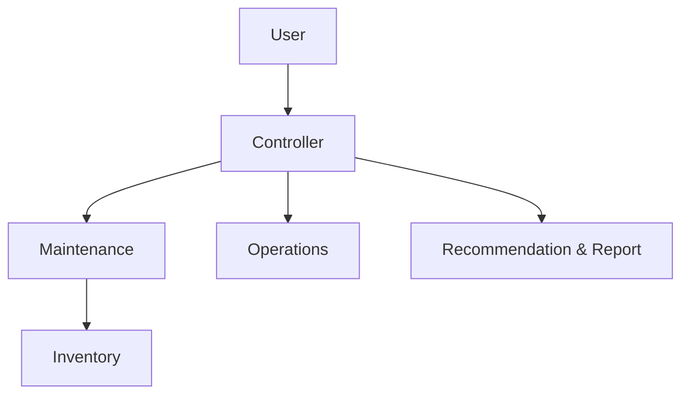
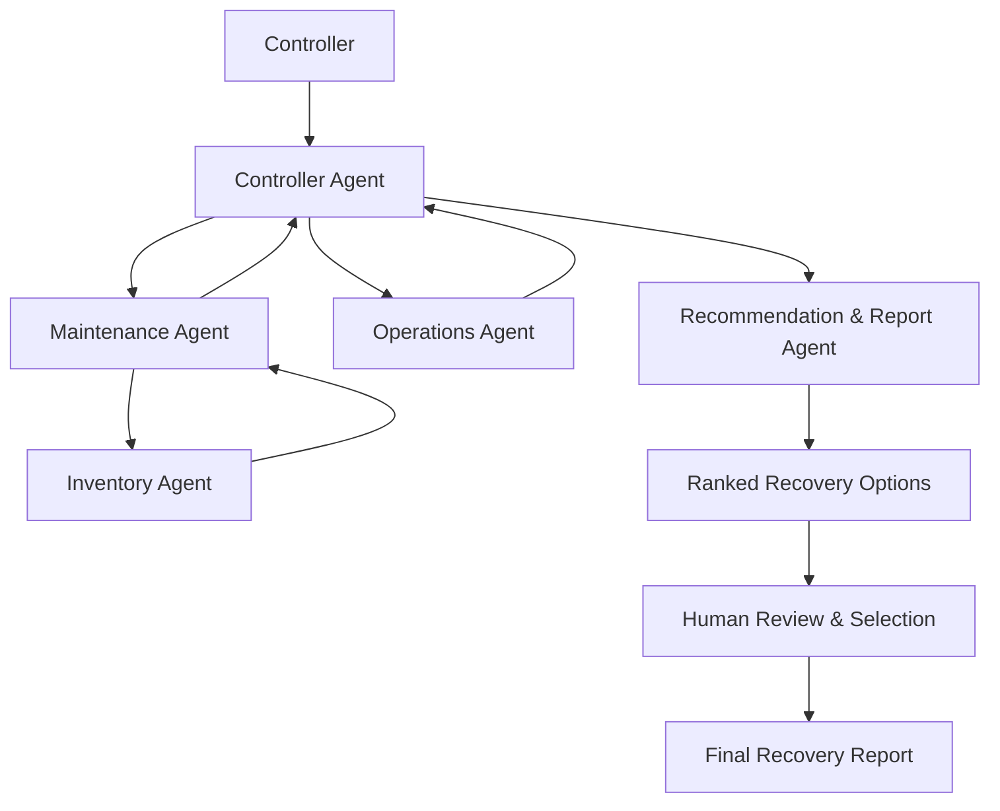
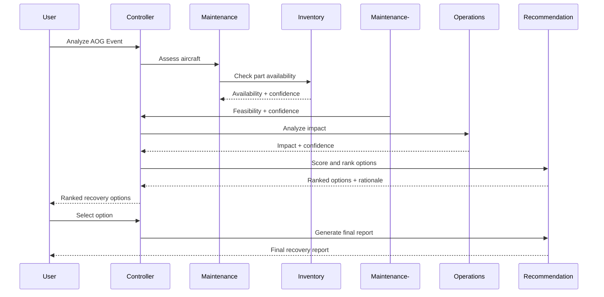

# Aircraft-On-Ground (AOG) Recovery Coordinator
## FDEUS03 Capstone Project
### Agent-to-Agent (A2A) Recovery Decision Support System using Google ADK

> Enterprise Capstone Proposal for Air Operations Workbench

---

# 1. Executive Summary

The Aircraft-On-Ground (AOG) Recovery Coordinator is an Agent-to-Agent (A2A) solution built using Google ADK. The platform orchestrates specialized agents across Maintenance, Inventory, and Operations, with a Recommendation & Report agent that scores and ranks recovery options.

Goals:
- Reduce AOG duration
- Improve decision quality
- Enable explainable recommendations
- Demonstrate enterprise-grade multi-agent orchestration
- Maintain human approval for all operational actions

---
# 2. Business Problem

When an aircraft becomes AOG, multiple teams must coordinate:
- Maintenance
- Materials
- Logistics
- Operations
- Fleet Control

Typical questions:
- Can the aircraft be repaired?
- Is the part available?
- Can another aircraft be substituted?
- What is the operational impact?

---
# 3. Value Proposition

Benefits:
- Faster recovery decisions
- Reduced aircraft downtime
- Improved fleet utilization
- Better inventory visibility
- Explainable decision making

---
# 4. Why A2A vs Deterministic Solutions

Deterministic systems answer:

```text
IF part available THEN repair
```

Agentic systems evaluate:

```text
Repair Now
Transfer Part
Swap Aircraft
Delay Flight
Expedite Shipment
```

and recommend the best option.

---
# 5. Solution Overview

The Controller Agent orchestrates specialized agents.



---
# 6. Agent Architecture

## Controller Agent (Main Orchestrator)

Responsibilities:
- Receive AOG incident information
- Create recovery analysis plan
- Coordinate specialized agents
- Aggregate agent responses
- Request recommendation generation
- Manage Human-in-the-Loop workflow
- Generate final recovery package

Inputs:
- Aircraft ID
- Failure code
- Airport location
- Scheduled flights

Outputs:
- Ranked recovery alternatives
- Recovery recommendation request

---

## Maintenance Agent

Responsibilities:
- Assess repair feasibility
- Estimate repair duration
- Validate technician availability
- Identify replacement part requirements

Outputs:

```json
{
  "repair_possible": true,
  "repair_duration_hours": 3,
  "required_part": "Hydraulic Pump",
  "maintenance_confidence": 0.94
}
```

---

## Inventory Agent

Responsibilities:
- Verify part availability
- Locate alternate inventory
- Evaluate inventory transfer options

Outputs:

```json
{
  "part_available": true,
  "inventory_location": "MEM",
  "quantity": 2,
  "availability_confidence": 0.98
}
```

**Note:** Inventory Agent only communicates with the Maintenance Agent.

---

## Operations Agent

Responsibilities:
- Evaluate operational impact
- Analyze aircraft swap opportunities
- Estimate passenger disruption
- Calculate schedule impact

Outputs:

```json
{
  "swap_available": true,
  "delay_minutes": 45,
  "affected_flights": 2,
  "operations_confidence": 0.91
}
```

---

## Recommendation & Report Agent

Responsibilities:
- Consolidate agent findings
- Score recovery alternatives
- Rank recommendations
- Generate explainable rationale
- Produce recommendation report
- Generate final report after human approval

Outputs:
- Ranked recovery options
- Decision rationale
- Final recovery report

---
# 6A. Decision Scoring Framework

Every recovery alternative receives a weighted score.

## Scoring Factors

| Factor | Weight |
|--------|--------|
| Recovery Time | 30% |
| Operational Impact | 25% |
| Inventory Availability | 20% |
| Maintenance Feasibility | 15% |
| Cost Impact | 5% |
| Risk Level | 5% |

## Example Scoring

| Option | Score |
|--------|-------|
| A - Repair Aircraft | 92 |
| B - Aircraft Swap | 88 |
| C - Transfer Part | 81 |
| D - Delay Flight | 63 |

The highest score becomes the recommended recovery strategy.

---
# 6B. Explainability Framework

To ensure transparent decision support, every recommendation includes:
- Score breakdown
- Contributing factors
- Supporting system data
- Alternative options
- Confidence score
- Source references

Example:

```text
Recommended Option: Repair Aircraft
Confidence: 94%
Reason:
- Part available locally
- Repair estimated at 3 hours
- Lower operational impact
- No aircraft swap required
```

---
# 6C. Structured Output Model

All recommendations must comply with a validated schema. Output is validated before display.

```python
from pydantic import BaseModel

class RecoveryRecommendation(BaseModel):
    recommended_option: str
    confidence_score: float
    estimated_recovery_time_hours: float
    rationale: str
    alternative_options: list[str]
    data_sources: list[str]
    risk_level: str
```

Benefits:
- Consistent outputs
- Validation before display
- Easier testing
- Explainable recommendations

---
# 6D. Confidence Scoring

Each agent returns a confidence score:
- Maintenance Agent = 94%
- Inventory Agent = 98%
- Operations Agent = 91%

The Recommendation & Report Agent calculates the Overall Recommendation Confidence as the weighted agent confidence (94% in this example).

Low-confidence recommendations (<70%) automatically require additional human review.

---
# 6E. Recommendation Report Example

```text
Aircraft: FX123
Failure: Hydraulic Pump Failure
Recommended Option: Repair Aircraft
Confidence: 94%
Estimated Recovery Time: 3 Hours

Supporting Evidence:
- Inventory available
- Qualified technician available
- Lowest operational disruption

Alternative Options:
1. Aircraft Swap
2. Part Transfer
3. Flight Delay

Decision Status: Pending Human Approval
```

---
# 6F. Agent Failure & Fallback Handling

The system must continue functioning when individual agents fail.

## Scenario: Inventory API Unavailable

```text
Inventory Agent Failure
    ↓
Retry 3 Times
    ↓
Use Cached Inventory Data
    ↓
Flag Reduced Confidence
```

## Scenario: Operations Agent Timeout

```text
Operations Agent Timeout
    ↓
Controller Continues Workflow
    ↓
Recommendation Generated
    ↓
Warning Included in Report
```

## Scenario: Conflicting Data

```text
Maintenance Duration = 3 Hours
Operations Duration = 7 Hours
    ↓
Controller Flags Conflict
    ↓
Human Review Required
```

---
# 6G. Functional Validation Test Cases

## Test Case 1
- Input: Part Available, Technician Available, No Schedule Conflict
- Expected Result: Recommendation = Repair Aircraft

## Test Case 2
- Input: Part Not Available, Alternative Aircraft Available
- Expected Result: Recommendation = Aircraft Swap

## Test Case 3
- Input: Inventory API Down
- Expected Result: System uses cached data, confidence reduced, warning displayed

## Test Case 4
- Input: Multiple options within 2% score difference
- Expected Result: Both options presented, human selection required

---
# 7. High-Level Architecture Diagram



---
# 8. Sequence Diagram



---
# 9. Tool & API Mapping

| Agent | APIs |
|---------|---------|
| Maintenance | Work Orders API, Maintenance History API |
| Inventory | Inventory API, Parts Catalog API, Shipment API |
| Operations | Fleet API, Flight Schedule API |
| Recommendation & Report | Cost Models, Analytics API |

---
# 10. Security Guardrails

- Read-only API access
- RBAC
- Least privilege
- Audit trail
- Prompt injection protection
- Tool whitelisting

---
# 11. Safety Controls

- Advisory only
- Human approval mandatory
- Explainable outputs
- Source attribution
- Operational safeguards

---
# 12. Risk Analysis & Mitigations

## Hallucinations
Mitigation: RAG and tool grounding.

## Stale Data
Mitigation: Timestamp validation.

## Compliance Risk
Mitigation: Policy verification.

## Agent Failure
Mitigation: Retries and fallbacks.

---
# 13. Human-in-the-Loop Governance

```text
AOG Event
    ↓
Controller Agent
    ↓
Maintenance Analysis
    ↓
Inventory Validation
    ↓
Operations Assessment
    ↓
Recommendation Generation
    ↓
Ranked Recovery Options
    ↓
Human Review
    ↓
Human Selects Option
    ↓
Final Recovery Report
```

The AI recommends.

The human decides.

The system documents the decision.

---
# 14. ADK Implementation Details

## Suggested Structure

```python
root_agent = ControllerAgent(
    sub_agents=[
        MaintenanceAgent(),   # consults InventoryAgent
        OperationsAgent(),
        RecommendationReportAgent()
    ]
)
```

## Sample Agent

```python
from google.adk.agents import Agent

maintenance_agent = Agent(
    name="maintenance_agent",
    model="gemini-2.5-pro",
    instruction="Analyze maintenance feasibility"
)
```

## Controller Example

```python
from google.adk.agents import SequentialAgent

controller = SequentialAgent(
    name="controller_agent",
    sub_agents=[
        maintenance_agent,
        operations_agent,
        recommendation_report_agent
    ]
)
```

---
# 15. Repository Structure

```text
aog-recovery-coordinator/
├── agents/
├── tools/
├── workflows/
├── scenarios/
├── api/
├── ui/
├── docs/
├── tests/
└── README.md
```

---
# 16. 3-Day Implementation Plan

## Day 1
- Agent creation
- Mock APIs

## Day 2
- Agent orchestration
- Recommendation workflow

## Day 3
- UI
- Demonstration
- Presentation

---
# 17. Demo Walkthrough

Scenario:
Aircraft FX123 experiences hydraulic pump failure.

Results:
1. Maintenance estimates 3-hour repair (confidence 94%).
2. Inventory confirms the replacement part is available (confidence 98%).
3. Operations evaluates the swap option (confidence 91%).
4. Recommendation & Report Agent scores and ranks recovery options.
5. Controller presents ranked options with rationale to the human.
6. Human selects an option; final recovery report is generated.

---
# 18. Architecture Decision Record (ADR)

## ADR-001: Use Multi-Agent Architecture
Reason: Domain separation and explainability.

## ADR-002: Human Approval Required
Reason: Safety and compliance.

## ADR-003: Read Only Access
Reason: Risk reduction.

---
# 19. Future Roadmap

Phase 2
- Fleet Readiness Assessment
- Deferred Maintenance Risk Analyzer

Phase 3
- Enterprise Air Operations Agent Ecosystem

---
# 20. Capstone Success Criteria

- ADK orchestration
- Multiple collaborating agents (agent-to-agent communication)
- Specialized domain reasoning
- Structured, schema-validated recommendation outputs
- Confidence scoring
- Explainable recommendations
- Human-in-the-loop selection and approval
- Final report generation
- Fault tolerance and fallback handling
- Security controls
- Business relevance

---
# Appendix A - Complete A2A Concept

The AOG Recovery Coordinator demonstrates true Agent-to-Agent collaboration across Maintenance, Inventory, Operations and Recommendation domains. The solution serves as a decision-support platform that augments human expertise while maintaining full operational control with authorized personnel.
