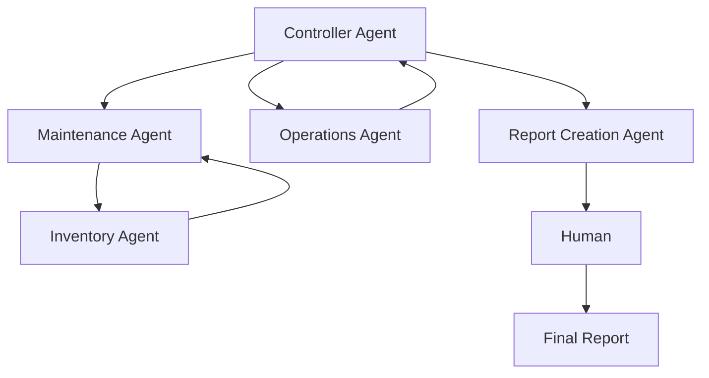
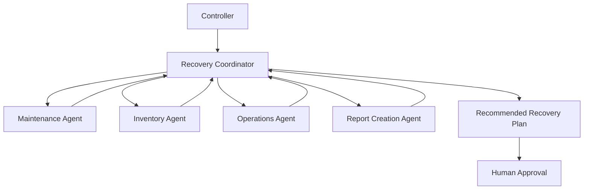
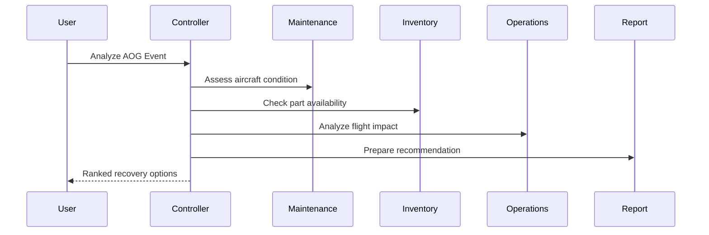

# Aircraft-On-Ground (AOG) Recovery Coordinator
## FDEUS03 Capstone Project
### Agent-to-Agent (A2A) Recovery Decision Support System using Google ADK

> Enterprise Capstone Proposal for Air Operations Workbench

---

# 1. Executive Summary

The Aircraft-On-Ground (AOG) Recovery Coordinator is an Agent-to-Agent (A2A) solution built using Google ADK. The platform orchestrates specialized agents across Maintenance, Inventory, Operations, and Recommendation management to recommend the optimal aircraft recovery strategy.

The goal is to reduce AOG duration, improve decision quality, and provide explainable recommendations while keeping the human operator in the loop for final approval.

Key goals:
- Reduce aircraft downtime
- Improve recovery decision quality
- Enable explainable recommendations
- Demonstrate enterprise-grade multi-agent orchestration
- Maintain human approval for operational actions

---

# 2. Business Problem

When an aircraft becomes AOG, multiple teams must coordinate quickly across technical and operational domains.

Typical questions include:
- Can the aircraft be repaired?
- Is the required part available?
- Can another aircraft be substituted?
- What is the operational impact of delaying or rerouting flights?

Without a coordinated system, teams often work in silos, creating delays, duplicate analysis, and slower recovery decisions.

---

# 3. Value Proposition

Benefits:
- Faster recovery decisions
- Reduced aircraft downtime
- Improved fleet utilization
- Better inventory visibility
- Clearer trade-off analysis across recovery options
- Explainable decision support for human operators

---

# 4. Why A2A vs Deterministic Solutions

Deterministic systems typically follow rules such as:

```text
IF part available THEN repair
```

Agentic systems evaluate multiple operational paths, including:

```text
Repair Now
Transfer Part
Swap Aircraft
Delay Flight
Use Alternate Recovery Plan
```

The system recommends the best option based on evidence rather than a single hard-coded rule.

---

# 5. Solution Overview

The Recovery Coordinator orchestrates a focused decision flow led by the Controller Agent. The controller receives the AOG event, delegates to the specialist agents, and then routes the recommendation to the human decision-maker for approval.



This mirrors the image pattern: the Controller is at the top, the Maintenance and Operations branches are subordinate, Inventory is tied to the maintenance workflow, and the final recommendation is delivered to the Human for approval.

---

# 6. Agent Architecture

## Controller Agent
Responsibilities:
- Orchestration
- Planning
- Recommendation generation
- Coordination across specialist agents

## Maintenance Agent
- Repair analysis
- Work package feasibility
- Maintenance turnaround estimation
- Technical recovery assessment

## Inventory Agent
- Inventory analysis
- Part availability validation
- Alternate part sourcing evaluation
- Material readiness assessment

## Operations Agent
- Flight impact analysis
- Swap recommendation evaluation
- Schedule disruption analysis
- Operational prioritization

## Report Creation Agent
- Consolidates findings from other agents
- Produces the ranked recovery recommendation
- Highlights trade-offs, assumptions, and risks
- Prepares the final recommendation for human approval

---

# 7. High-Level Architecture Diagram



This diagram reflects the scoped architecture in the image: the Controller Agent coordinates the flow, Maintenance and Inventory assess the technical feasibility, Operations evaluates business impact, and the Report Creation Agent prepares the final recommendation for the human decision-maker.

---

# 8. Sequence Diagram



---

# 9. Tool & API Mapping

| Agent | Functional Focus |
|---------|------------------|
| Maintenance | Work orders, maintenance records, repair feasibility |
| Inventory | Parts inventory, supplier availability, material readiness |
| Operations | Flight schedules, route impact, aircraft substitution |
| Report Creation | Recommendation synthesis and decision summary |

---

# 10. Security Guardrails

- Read-only access where possible
- Role-based access control
- Least privilege access
- Audit trail for recommendations
- Prompt injection awareness
- Tool whitelisting

---

# 11. Safety Controls

- Advisory only
- Human approval required
- Explainable outputs
- Operational safeguards
- Clear decision rationale

---

# 12. Human-in-the-Loop Governance

```text
AI Recommendation
    ↓
Human Review
    ↓
Human Approval
    ↓
Operational Action
```

This ensures the platform supports decision-making without bypassing accountability. The agent recommends; the human approves.

---

# 13. Expected Business Impact

The solution is intended to help air operations teams act faster when time-sensitive recovery decisions are needed. It brings together technical feasibility, material readiness, and operational disruption into a single coordinated decision flow.

Expected impact:
- Faster AOG response
- Better resource prioritization
- More consistent decision-making
- Greater visibility across teams
- Lower disruption from manual coordination delays

---

# 14. Final Positioning

This project is scoped to a focused Agent-to-Agent recovery decision support model aligned to the architecture shown in the image. It removes the Logistics and Risk Agent scope while preserving the core decision-making flow around the Controller, Maintenance, Inventory, Operations, and Report Creation agents.

The result is a clear, operationally relevant capstone solution that remains realistic, explainable, and suitable for a human-approved aircraft recovery process.
