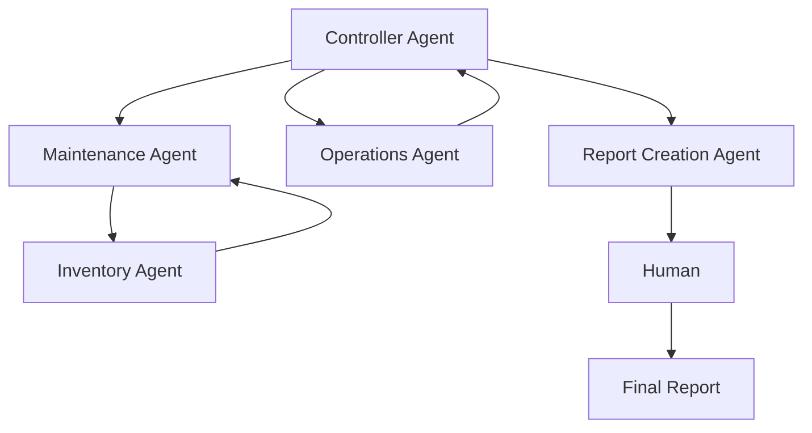
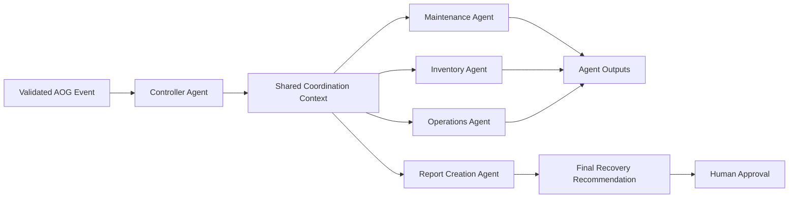
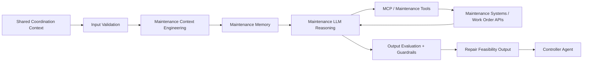
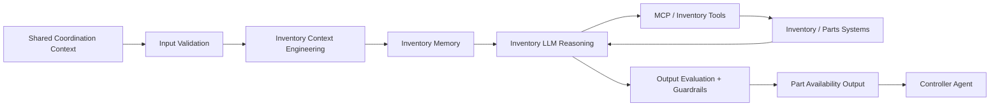
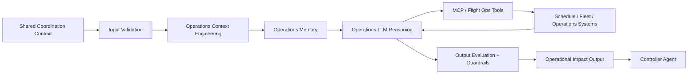
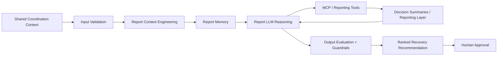
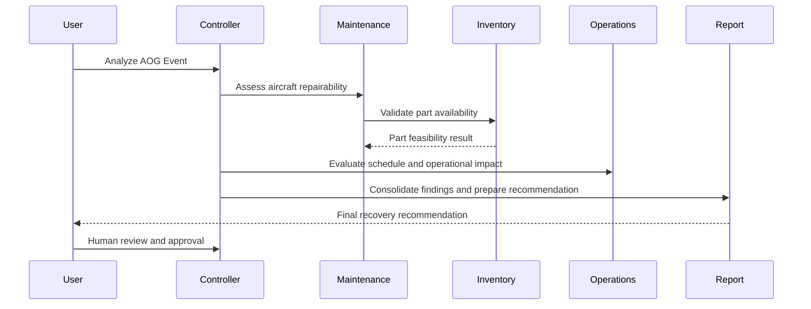

# Aircraft-On-Ground (AOG) Recovery Coordinator
## FDEUS03 Capstone Project
### Agent-to-Agent (A2A) Recovery Decision Support System using Google ADK

> Enterprise Capstone Proposal for Air Operations Workbench

---

# 1. Executive Summary

The Aircraft-On-Ground (AOG) Recovery Coordinator is an Agent-to-Agent (A2A) solution built using Google ADK. The platform orchestrates specialized agents across Maintenance, Inventory, Operations, and Recommendation management to recommend the optimal aircraft recovery strategy.

The goal is to reduce AOG duration, improve decision quality, and provide explainable recommendations while keeping the human operator in the loop for final approval.

Key goals:
- Reduce aircraft downtime
- Improve recovery decision quality
- Enable explainable recommendations
- Demonstrate enterprise-grade multi-agent orchestration
- Maintain human approval for operational actions

---

# 2. Business Problem

When an aircraft becomes AOG, multiple teams must coordinate quickly across technical and operational domains.

Typical questions include:
- Can the aircraft be repaired?
- Is the required part available?
- Can another aircraft be substituted?
- What is the operational impact of delaying or rerouting flights?

Without a coordinated system, teams often work in silos, creating delays, duplicate analysis, and slower recovery decisions.

---

# 3. Value Proposition

Benefits:
- Faster recovery decisions
- Reduced aircraft downtime
- Improved fleet utilization
- Better inventory visibility
- Clearer trade-off analysis across recovery options
- Explainable decision support for human operators

---

# 4. Why A2A vs Deterministic Solutions

Deterministic systems typically follow rules such as:

```text
IF part available THEN repair
```

Agentic systems evaluate multiple operational paths, including:

```text
Repair Now
Transfer Part
Swap Aircraft
Delay Flight
Use Alternate Recovery Plan
```

The system recommends the best option based on evidence rather than a single hard-coded rule.

## 4.1 Deterministic Responsibilities

These responsibilities are best handled by deterministic logic because they are rule-based and objective:

- Input validation and required-field checks
- Part availability checks against inventory thresholds
- Basic schedule conflict detection
- Minimum safety and approval gate checks
- Standard workflow routing and escalation rules
- Structured data transformations and status calculations

## 4.2 Non-Deterministic Responsibilities

These responsibilities require judgment, contextual reasoning, and trade-off analysis because the data is incomplete, dynamic, or conflicting:

- Assessing repairability under uncertain maintenance conditions
- Interpreting partial aircraft history and operational constraints
- Evaluating trade-offs between downtime, cost, and flight disruption
- Prioritizing among multiple recovery options with incomplete certainty
- Explaining recommendations in human-understandable terms
- Recommending a coordinated plan across maintenance, inventory, and operations

## 4.3 Why Deterministic Logic Cannot Fully Replace the Agents

A deterministic engine is useful for guardrails, validation, and workflow enforcement, but it cannot fully replace the specialized agents in this system because real AOG decisions are not based on one simple rule set. In practice, the system must reason across multiple domains at once:

- A part may be available but still not feasible because of lead time, certification, or maintenance constraints.
- The aircraft may be repairable but not the best option if the schedule impact is severe.
- A substitute aircraft may exist but may create operational or customer disruption elsewhere.
- The best recommendation depends on balancing technical feasibility, material readiness, and operational impact together.

For these reasons, deterministic logic should be used for validation and enforcement, while the agentic layer is used for reasoning, prioritization, and recommendation generation. This division preserves reliability while still enabling judgment-based decision support.

---

# 5. Solution Overview

The Recovery Coordinator orchestrates a focused decision flow led by the Controller Agent. The controller receives the AOG event, delegates to the specialist agents, and then routes the recommendation to the human decision-maker for approval.



This mirrors the image pattern: the Controller is at the top, the Maintenance and Operations branches are subordinate, Inventory is tied to the maintenance workflow, and the final recommendation is delivered to the Human for approval.

---

# 6. Agent Architecture

Each agent follows the same core pattern: validate input, retrieve local context, reason using an LLM, consult tools or external systems, apply deterministic guardrails, and evaluate the final output before returning it to the Controller or the human decision-maker.

This section describes the role-specific LLM responsibility, the deterministic controls, the non-deterministic reasoning, and the kind of questions each agent is designed to answer.

## Controller Agent
The Controller Agent is the main orchestrator. It receives the AOG event, delegates analysis to specialist agents, consolidates findings, and drives the final recommendation to the human decision-maker.

### 6.1 LLM Role
The Controller LLM acts as the coordination planner. It is not expected to make all technical decisions itself; instead, it decides which specialist agents are needed, what information must be gathered, and how to combine the outputs into a coherent recommendation.

### 6.2 Deterministic Responsibilities
- Validate the incoming AOG event structure
- Check required data fields and event completeness
- Standardize routing logic to the appropriate specialist agents
- Apply escalation rules and approval gates
- Create consistent report templates and output structure

### 6.3 Non-Deterministic Responsibilities
- Interpret incomplete or conflicting operational signals
- Decide which agent output is most relevant to the immediate disruption
- Prioritize and sequence the response workflow
- Synthesize a coordinated recovery narrative across teams
- Recommend the most credible decision path for human approval

### 6.4 Questions it seeks to answer
- What is the current AOG event and what decision needs to be made?
- Which specialist agents are relevant to this specific recovery case?
- How should the findings be combined into a single coordinated recommendation?
- What is the best recovery plan to present to the human approver?
- Which information is missing or uncertain and how should that affect the next step?

## Maintenance Agent
The Maintenance Agent assesses aircraft repairability and technical feasibility. It evaluates whether the aircraft can be recovered through repair and estimates practical maintenance constraints.

### 6.5 LLM Role
The Maintenance LLM acts as the aircraft technical analyst. It interprets maintenance records, repair history, work-order conditions, and engineering constraints to determine whether a repair path is viable under the current state of the aircraft.

### 6.6 Deterministic Responsibilities
- Validate required maintenance data and aircraft status fields
- Check work-order completeness and maintenance readiness conditions
- Detect obvious schedule conflicts or missing required actions
- Apply standard safety and approval checks
- Structure repair options into clear technical categories

### 6.7 Non-Deterministic Responsibilities
- Assess whether the aircraft is truly repairable under uncertain technical conditions
- Interpret partial maintenance history and ambiguous defect descriptions
- Estimate turnaround time when real-world constraints are not fully known
- Balance technical feasibility against operational urgency
- Recommend whether to repair, defer, or escalate a recovery path

### 6.8 Questions it seeks to answer
- Is the aircraft repairable in the current maintenance context?
- What inspection, parts, and labor are required for repair?
- How long will the aircraft need to remain grounded for maintenance?
- What technical risks or constraints could affect the recovery option?
- What is the confidence level in the technical recommendation and what assumptions drive it?

## Inventory Agent
The Inventory Agent supports maintenance-driven part validation. It checks whether the required material is available and whether alternate sourcing is feasible.

### 6.9 LLM Role
The Inventory LLM acts as the materials readiness specialist. It combines inventory data, stock availability, and supplier/transfer logic to determine whether the required part can be secured in time and under acceptable risk.

### 6.10 Deterministic Responsibilities
- Validate part number, location, quantity, and stock thresholds
- Check current availability against minimum requirements
- Match substitute or alternate part candidates using defined business rules
- Route sourcing decisions to the correct procurement or transfer path
- Compute expected lead times and material readiness status from structured data

### 6.11 Non-Deterministic Responsibilities
- Judge whether a part is feasible even when inventory data is incomplete or stale
- Interpret supplier delays, transfer constraints, or certification risk in practical terms
- Decide whether alternate parts are operationally acceptable
- Assess trade-offs between sourcing speed and long-term aircraft recovery risk
- Recommend the best material strategy under uncertain supply conditions

### 6.12 Questions it seeks to answer
- Is the required part available at the current location?
- Can the part be sourced from another station or supplier?
- What is the expected lead time for procurement or transfer?
- Is an alternate replacement feasible without increasing operational risk?
- Which material path is most likely to meet the recovery deadline with acceptable risk?

## Operations Agent
The Operations Agent evaluates the larger business impact of the AOG event, including schedule and substitution implications. It assesses how the recovery path affects operations and customer impact.

### 6.13 LLM Role
The Operations LLM acts as the disruption and prioritization analyst. It interprets flight schedules, fleet constraints, and route dependencies to determine which recovery option minimizes operational disruption while remaining feasible.

### 6.14 Deterministic Responsibilities
- Validate flight and schedule data relevant to the AOG event
- Detect route conflicts, aircraft assignment conflicts, and disruption triggers
- Evaluate standard substitution and re-accommodation rules
- Apply business priority logic and threshold-based impact checks
- Produce consistent operational impact summaries

### 6.15 Non-Deterministic Responsibilities
- Determine which disruption pattern is most damaging under uncertain schedule conditions
- Assess whether a swap, reroute, or delay is the least-bad recovery option
- Weigh customer impact, crew constraints, and fleet optimization trade-offs
- Recommend operational sequencing under incomplete real-time conditions
- Prioritize among multiple plausible recovery paths when the numbers alone are not decisive

### 6.16 Questions it seeks to answer
- What flights or routes are affected by the aircraft outage?
- Can the aircraft be swapped or substituted to reduce disruption?
- What is the operational cost of delay, reroute, or recovery action?
- Which recovery path minimizes business disruption while remaining feasible?
- What is the impact on customer commitments, schedule reliability, and aircraft utilization?

## Report Creation Agent
The Report Creation Agent consolidates the output from the other agents and prepares a final recommendation package for human review.

### 6.17 LLM Role
The Report LLM acts as the synthesis and communication layer. It combines specialist findings, highlights trade-offs and assumptions, and presents the final recommendation in a clear decision-ready format for the human approver.

### 6.18 Deterministic Responsibilities
- Standardize input formatting and aggregation rules
- Validate that all required agent outputs are present
- Check for missing, contradictory, or incomplete recommendations
- Apply report templates and structured summary layouts
- Produce status categories such as feasible, high-risk, or deferred

### 6.19 Non-Deterministic Responsibilities
- Rank recovery options based on incomplete and sometimes conflicting evidence
- Explain trade-offs between downtime, cost, disruption, and risk
- Interpret how assumptions change the recommendation
- Draft a human-readable explanation of why one option is preferred over another
- Bring together technical, material, and operational considerations into one narrative

### 6.20 Questions it seeks to answer
- Which recovery options are feasible based on all agent outputs?
- What are the trade-offs among repair, part transfer, and aircraft substitution?
- Which option is most likely to minimize downtime and disruption?
- How should the recommendation be explained clearly to a human approver?
- What assumptions, uncertainties, and risks should be clearly stated before approval?

### 6.21 Design Principle for All Agents
Each agent should be built around the same pattern:
- Input validation
- Context engineering and local memory
- LLM reasoning over domain-specific context
- Tool or API access to relevant systems
- Deterministic guardrails before output release
- Output evaluation before submitting the result to the next stage

This structure makes each role easier to develop as an LLM-based specialist while keeping the overall system coordinated and explainable.

---

# 7. Individual Agent-Level Architecture

The high-level controller flow is useful for overview, but each specialist agent has its own internal reasoning and memory flow. The architecture below breaks the system down by agent so each role is clearly defined.

## 7.1 Controller Agent Architecture



The Controller Agent is responsible for shared context coordination, task routing, and synthesis of the final recommendation. It does not own the detailed local reasoning memory for every agent; instead, it keeps only the shared state needed to coordinate the workflow.

Controller responsibilities:
- Receive validated AOG input
- Maintain shared coordination context
- Route tasks to the relevant agents
- Aggregate intermediate outputs
- Generate final report for human approval

## 7.2 Maintenance Agent Architecture



The Maintenance Agent focuses on technical feasibility. It validates incoming maintenance context, uses local memory and tool access to assess repairability, and evaluates its output before sending the result back to the Controller.

Maintenance-specific elements:
- Repairability assessment
- Maintenance history and work-order context
- Local domain memory for aircraft condition and constraints
- Input validation before reasoning
- Output evaluation before handoff
- Tools for work-order and technical systems

## 7.3 Inventory Agent Architecture



The Inventory Agent focuses on material readiness. It validates incoming requests, checks part availability and alternate sourcing, and evaluates its output before returning the result to the Controller.

Inventory-specific elements:
- Stock and location context
- Supplier and alternate sourcing data
- Material readiness and substitution logic
- Input validation before reasoning
- Output evaluation before handoff
- Tool access to inventory APIs and catalogs

## 7.4 Operations Agent Architecture



The Operations Agent focuses on schedule and fleet impact. It validates the request, evaluates operational disruption and substitution options, and checks the output quality before returning the result to the Controller.

Operations-specific elements:
- Flight and route impact analysis
- Fleet and schedule context
- Operational risk framing
- Input validation before reasoning
- Output evaluation before handoff
- API access to schedule and fleet systems

## 7.5 Report Creation Agent Architecture



The Report Creation Agent is responsible for synthesizing findings from the other agents and producing the final recommendation. It validates the aggregated information, applies context-based reasoning, and evaluates the generated recommendation before it is presented to the human operator.

Report-specific elements:
- Recommendation synthesis
- Trade-off comparison
- Risk and assumption highlighting
- Input validation before synthesis
- Output evaluation before human review
- Final report generation for human approval

## 7.6 Shared Design Principles Across Agents

Each specialist agent follows the same internal pattern:
- Input from shared coordination context
- Local context engineering and memory management
- LLM reasoning over relevant domain data
- MCP/tool access to live systems
- Structured output for downstream use
- Final output returned to the Controller or to the human

This structure keeps the solution readable and aligned with the image while making the individual agent responsibilities explicit. The system remains coordinated at the controller level without overloading the Controller with every local detail of each agent's reasoning process.

---

# 8. Sequence Diagram



---

# 9. Tool & API Mapping

| Agent | Functional Focus |
|---------|------------------|
| Maintenance | Work orders, maintenance records, repair feasibility |
| Inventory | Parts inventory, supplier availability, material readiness |
| Operations | Flight schedules, route impact, aircraft substitution |
| Report Creation | Recommendation synthesis and decision summary |

---

# 10. Security Guardrails

- Read-only access where possible
- Role-based access control
- Least privilege access
- Audit trail for recommendations
- Prompt injection awareness
- Tool whitelisting

---

# 11. Safety Controls

- Advisory only
- Human approval required
- Explainable outputs
- Operational safeguards
- Clear decision rationale

---

# 12. Human-in-the-Loop Governance

```text
AI Recommendation
    ↓
Human Review
    ↓
Human Approval
    ↓
Operational Action
```

This ensures the platform supports decision-making without bypassing accountability. The agent recommends; the human approves.

---

# 13. Expected Business Impact

The solution is intended to help air operations teams act faster when time-sensitive recovery decisions are needed. It brings together technical feasibility, material readiness, and operational disruption into a single coordinated decision flow.

Expected impact:
- Faster AOG response
- Better resource prioritization
- More consistent decision-making
- Greater visibility across teams
- Lower disruption from manual coordination delays

---

# 14. Final Positioning

This project is scoped to a focused Agent-to-Agent recovery decision support model aligned to the architecture shown in the image. It removes the Logistics and Risk Agent scope while preserving the core decision-making flow around the Controller, Maintenance, Inventory, Operations, and Report Creation agents.

The result is a clear, operationally relevant capstone solution that remains realistic, explainable, and suitable for a human-approved aircraft recovery process.
