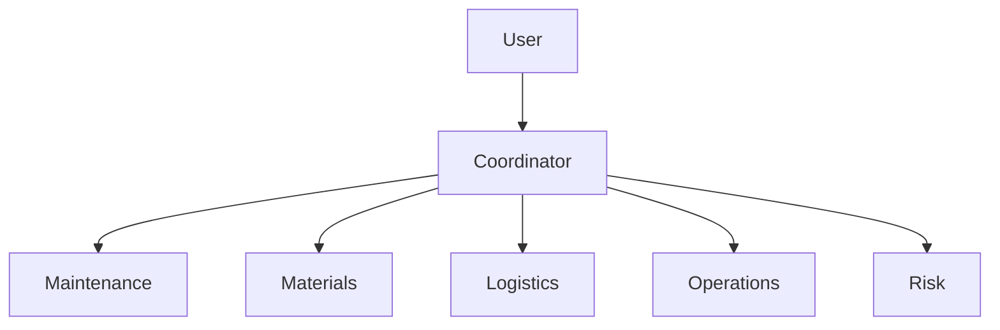
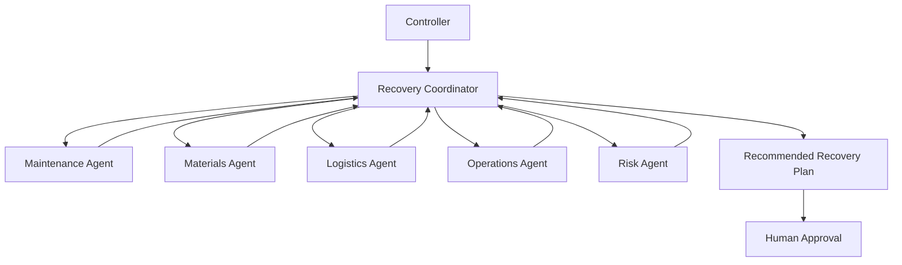
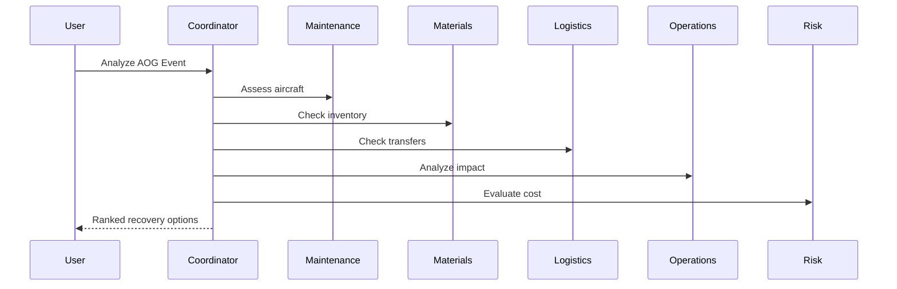

# Aircraft-On-Ground (AOG) Recovery Coordinator
## FDEUS03 Capstone Project
### Agent-to-Agent (A2A) Recovery Decision Support System using Google ADK

> Enterprise Capstone Proposal for Air Operations Workbench

---

# 1. Executive Summary

The Aircraft-On-Ground (AOG) Recovery Coordinator is an Agent-to-Agent (A2A) solution built using Google ADK. The platform orchestrates specialized agents across Maintenance, Materials, Logistics, Operations, and Risk Management to recommend the optimal aircraft recovery strategy.

Goals:
- Reduce AOG duration
- Improve decision quality
- Enable explainable recommendations
- Demonstrate enterprise-grade multi-agent orchestration
- Maintain human approval for all operational actions

---
# 2. Business Problem

When an aircraft becomes AOG, multiple teams must coordinate:
- Maintenance
- Materials
- Logistics
- Operations
- Fleet Control

Typical questions:
- Can the aircraft be repaired?
- Is the part available?
- Can another aircraft be substituted?
- What is the operational impact?

---
# 3. Value Proposition

Benefits:
- Faster recovery decisions
- Reduced aircraft downtime
- Improved fleet utilization
- Better inventory visibility
- Explainable decision making

---
# 4. Why A2A vs Deterministic Solutions

Deterministic systems answer:

```text
IF part available THEN repair
```

Agentic systems evaluate:

```text
Repair Now
Transfer Part
Swap Aircraft
Delay Flight
Expedite Shipment
```

and recommend the best option.

---
# 5. Solution Overview

The Recovery Coordinator orchestrates specialized agents.



---
# 6. Agent Architecture

## Recovery Coordinator Agent
Responsibilities:
- Orchestration
- Planning
- Recommendation generation

## Maintenance Agent
- Repair analysis
- Work package feasibility

## Materials Agent
- Inventory analysis
- Alternate part sourcing

## Logistics Agent
- Shipment planning
- Transfer optimization

## Operations Agent
- Flight impact analysis
- Swap recommendations

## Risk Agent
- Cost and risk evaluation

---
# 7. High-Level Architecture Diagram



---
# 8. Sequence Diagram



---
# 9. Tool & API Mapping

| Agent | APIs |
|---------|---------|
| Maintenance | Work Orders API, Maintenance History API |
| Materials | Inventory API, Parts Catalog API |
| Logistics | Shipment API, Tracking API |
| Operations | Fleet API, Flight Schedule API |
| Risk | Cost Models, Analytics API |

---
# 10. Security Guardrails

- Read-only API access
- RBAC
- Least privilege
- Audit trail
- Prompt injection protection
- Tool whitelisting

---
# 11. Safety Controls

- Advisory only
- Human approval mandatory
- Explainable outputs
- Source attribution
- Operational safeguards

---
# 12. Risk Analysis & Mitigations

## Hallucinations
Mitigation: RAG and tool grounding.

## Stale Data
Mitigation: Timestamp validation.

## Compliance Risk
Mitigation: Policy verification.

## Agent Failure
Mitigation: Retries and fallbacks.

---
# 13. Human-in-the-Loop Governance

```text
AI Recommendation
    ↓
Human Review
    ↓
Human Approval
    ↓
Operational Action
```

---
# 14. ADK Implementation Details

## Suggested Structure

```python
root_agent = RecoveryCoordinatorAgent(
    sub_agents=[
        MaintenanceAgent(),
        MaterialsAgent(),
        LogisticsAgent(),
        OperationsAgent(),
        RiskAgent()
    ]
)
```

## Sample Agent

```python
from google.adk.agents import Agent

maintenance_agent = Agent(
    name="maintenance_agent",
    model="gemini-2.5-pro",
    instruction="Analyze maintenance feasibility"
)
```

## Coordinator Example

```python
from google.adk.agents import SequentialAgent

coordinator = SequentialAgent(
    name="recovery_coordinator",
    sub_agents=[
        maintenance_agent
    ]
)
```

---
# 15. Repository Structure

```text
aog-recovery-coordinator/
├── agents/
├── tools/
├── workflows/
├── scenarios/
├── api/
├── ui/
├── docs/
├── tests/
└── README.md
```

---
# 16. 3-Day Implementation Plan

## Day 1
- Agent creation
- Mock APIs

## Day 2
- Agent orchestration
- Recommendation workflow

## Day 3
- UI
- Demonstration
- Presentation

---
# 17. Demo Walkthrough

Scenario:
Aircraft FX123 experiences hydraulic pump failure.

Results:
1. Maintenance estimates 3-hour repair.
2. Materials finds replacement part.
3. Logistics calculates transfer ETA.
4. Operations evaluates swap option.
5. Risk compares alternatives.
6. Coordinator ranks recovery options.

---
# 18. Architecture Decision Record (ADR)

## ADR-001: Use Multi-Agent Architecture
Reason: Domain separation and explainability.

## ADR-002: Human Approval Required
Reason: Safety and compliance.

## ADR-003: Read Only Access
Reason: Risk reduction.

---
# 19. Future Roadmap

Phase 2
- Fleet Readiness Assessment
- Deferred Maintenance Risk Analyzer

Phase 3
- Enterprise Air Operations Agent Ecosystem

---
# 20. Capstone Success Criteria

- ADK orchestration
- Multiple collaborating agents
- Explainable outcomes
- Security controls
- Human governance
- Business relevance

---
# Appendix A - Complete A2A Concept

The AOG Recovery Coordinator demonstrates true Agent-to-Agent collaboration across Maintenance, Materials, Logistics, Operations and Risk domains. The solution serves as a decision-support platform that augments human expertise while maintaining full operational control with authorized personnel.
